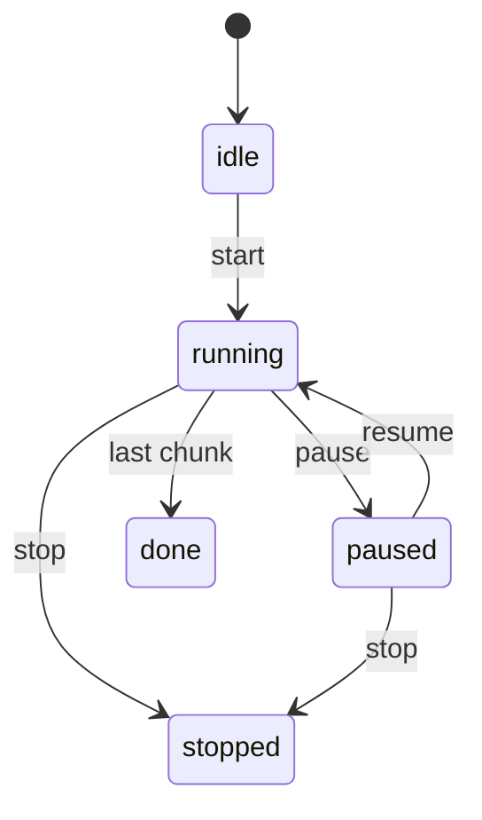

# New Project Plan: TTS-Only Service with Pause/Resume

## 0. Project Setup and Handoff (read first)

This plan was written in a session inside the Kokoro-FastAPI repo. The implementation happens in a new project, KTTS. Sections 1 to 4 hold the analysis, decisions, design, and steps.

### Folder layout

```
~/Documents/Projects/GitHub/Kokoro-NK
   Kokoro-FastAPI/      reference project, never modified
   KTTS/                new project, own git repo, own uv venv
      pyproject.toml
      src/ktts/
      tests/
      docs/New Project Plan.md
   Kokoro-NK.code-workspace
```

- `Kokoro-FastAPI/` is a read-only reference: code to copy and read only. Do not edit, commit to, or run installs inside it. Its only change is this plan file, to be moved into `KTTS/docs/` as `New Project Plan.md`; after the move the folder is untouched.
- The workspace file `~/Documents/Projects/GitHub/Kokoro-NK/Kokoro-NK.code-workspace` — a sibling of both folders, not inside either repo — lists `"KTTS"` first, then `"Kokoro-FastAPI"`, with `"files.readonlyInclude": {"Kokoro-FastAPI/**": true}` in its settings (relative to the workspace file's own folder). Since `Kokoro-NK/` is not itself a git repo, the workspace file is simply untracked; if `Kokoro-NK` ever becomes a repo, gitignore it because its contents are machine-specific.
- Copy needed modules into `KTTS/src/ktts/` instead of symlinking or importing (tests go in `KTTS/tests/`). Record the Kokoro-FastAPI commit they came from in the README.
- KTTS has its own `git init`, its own `uv` environment (`uv init` in `KTTS/` → `pyproject.toml` + `.venv`, with `KTTS/.venv` selected as the interpreter for the KTTS folder), and its own `AGENTS.md` if one is required.
  
  
### Summary of decisions

| Topic | Decision |
|---|---|
| Language | Python 3.10+, `uv`, `argparse`, stdlib terminal handling (`tty`, `termios`, `asyncio`). Shell only for helper scripts if at all. |
| Interface | One flat CLI command `ktts` plus an importable library. No HTTP server, UI, or Docker. |
| Platform | macOS (Apple Silicon), CPU only, personal use, not distributed. |
| Language support | English only (`misaki[en]`), foreign and made-up names must be spoken, never silently dropped. |
| Output | File only, WAV in the first iteration, m4a (ffmpeg or PyAV) in the next. |
| Pause control | Interactive: Space pauses/resumes, `q` or Ctrl-C saves and exits. Ctrl-C only when there is no terminal. |
| Persistence | Paused sessions survive restart. One folder per session with `session.json` and one WAV per chunk. |
| Input | Plain text, positional string or `-f/--file`. |
| Cleanup | Brew-style prompt at the start of a new session to delete old finished or abandoned sessions. Never automatic. |
| Licensing | Not a concern for personal use. |

CLI flags and output naming are specified in Phase 5, item 2. Risks are in section 4.

### Conventions for the implementing agent

- Follow the Kokoro-FastAPI house style from its `AGENTS.md`: no em-dashes, comments only for decision points or gotchas, keep changes small, when in doubt do less.
- Every behavior change ships with a test.
- Pin dependency versions to those in the source `pyproject.toml`; this stack is version-sensitive.
- Do not restructure or run the Kokoro-FastAPI Dockerfiles; they are out of scope.
- eSpeak must be installed locally (`brew install espeak-ng`); `ffmpeg` is needed only for the m4a iteration.

### Verified versus unverified

- Verified by reading code: chunking flow in `tts_service.py` and `text_processor.py`, the duplicate G2P in `phonemizer.py`, silent phoneme dropping in `vocabulary.tokenize()`, and the resume-by-index approach in `tts_enhanced.py` (which calls `_get_voices_path` while the base class defines `get_voices_path`, so it likely fails as written).
- Not yet verified, to confirm early: how misaki's English G2P handles foreign and made-up names, the actual pause latency on CPU, whether the English normalizer requires spaCy, and whether `unicode-segmentation-rs` and the other pinned packages install cleanly on Apple Silicon without the `[ja,ko,zh]` extras.

### Suggested order of work

Phase 1 (bootstrap), then a spike for the unverified items above, then Phases 2 to 5 in order, with Phase 6 tests written alongside each phase. Phase 7 packaging last. Stop for review after Phase 1, after the spike, and after the first end-to-end `ktts "hello"` run.

## 1. Review Findings

### TTS pipeline (what to keep)

| Area | Location | Notes |
|---|---|---|
| Orchestration | `api/src/services/tts_service.py` | `generate_audio_stream()` iterates `smart_split()` chunks, calls `_process_chunk()` per chunk, finalizes the writer on a last-chunk sentinel. |
| Backend | `api/src/inference/kokoro_v1.py` | Wraps `KPipeline` per `lang_code`; `generate()` yields `AudioChunk`; GPU OOM retry; word timestamps. |
| Model lifecycle | `api/src/inference/model_manager.py` | Singleton, warmup, idle auto-unload, `hold()` for active requests. |
| Text processing | `api/src/services/text_processing/` | `normalization/` (per-language), `text_processor.py` (`smart_split`: sentence, clause, word fallback by token budget; `[pause:Ns]` tags), `phonemizer.py`, `vocabulary.py`. |
| Encoding | `api/src/services/streaming_audio_writer.py`, `audio.py` | PyAV encoder for wav/mp3/opus/flac/aac/pcm; `AudioNormalizer` trims and normalizes. |
| Existing pause hook | `api/src/services/tts_enhanced.py`, `api/src/main_enhanced.py` | `start_chunk_index` skips chunks and emits NDJSON `{chunk_index, audio_base64, chunk_text}`. Primitive resume by replay, no server-side state. Note it calls `_get_voices_path`, but the base class defines `get_voices_path`, so verify it works before reusing. |

### eSpeak usage

- eSpeak-NG is not called directly in the main path. `kokoro_v1.py` uses `KPipeline`, whose G2P (misaki) uses `espeakng-loader` + `phonemizer-fork` for non-English languages (es/fr/it/hi/pt) and as the English out-of-dictionary fallback.
- `text_processing/phonemizer.py` has a second, direct `phonemizer.backend.EspeakBackend` (en-us, en-gb) with post-fixes. It is used by `process_text_chunk()` and `get_sentence_info()` to count tokens for chunk sizing, not for the audio itself. This is a duplicate G2P pass and can drift from what the pipeline really phonemizes.
- Its lang map has a bogus `"z": "z"` entry.
- Environment: `PHONEMIZER_ESPEAK_PATH`, `PHONEMIZER_ESPEAK_DATA`, `ESPEAK_DATA_PATH` (see `docker/cpu/Dockerfile.optimized`, `start-cpu.sh`, `docs/internals/espeak-setup-fix.md`). Local runs need `espeak-ng` installed; on macOS, `brew install espeak-ng`.
- Risks: global `phonemizers` dict is not thread-safe (espeak library is process-global state); data path breakage is the most common setup failure; the Japanese/Chinese/Korean extras pull heavy dependencies (UniDic ~526MB).

### Voice cloning / out-of-scope features

- No true voice cloning exists. Related extras to drop: voice combining in `get_voices_path()` (`af_a+af_b`, weights, subtraction, temp `.pt` writes), `voice_manager` transients, `[voice:...]` tags, voice aliases, SSML, `/v1/audio/voices/combine`.
- Also drop for a lean core: OpenAI-compat mapping, captioned speech, debug and dev endpoints, download links, Helm chart, ROCm/GPU images (optional), `web/` and `kokoro-web/` duplicates, `ui/`.

### Natural seams for pause/resume

- Generation is already a chunked async generator, so pause is feasible at chunk boundaries without touching the model.
- The final `smart_split` output is deterministic for the same text/options, so a chunk index is a stable resume cursor.
- Gaps in the current design:
  - `_chunk_semaphore` and the client-disconnect `break` cancel rather than suspend.
  - `StreamingAudioWriter` state (PyAV container, `pts`) is lost on cancel, so resumed MP3/Opus streams have broken continuity.
  - `smart_split` is re-run in full on resume, which re-phonemizes skipped text.
  - `AudioNormalizer` state is per-stream, so resumed audio can have a level discontinuity.

## 2. Decisions (confirmed)

1. Interface: CLI plus an importable library the CLI calls. No HTTP server, no web UI.
2. Language: English only (`misaki[en]`), but foreign proper nouns and invented names must be spoken, never dropped.
3. Hardware: CPU only, macOS (Apple Silicon), personal use. No GPU/ROCm code, no Docker.
4. Paused sessions survive process restarts (on-disk session state).

Consequences:
- Drop FastAPI, uvicorn, pydantic-settings, CORS, streaming HTTP, docker/, charts/, web/.
- Drop torch CUDA paths (`_check_memory`, `_clear_memory`, OOM retry) and the `use_gpu` setting.
- Drop spaCy and `en-core-web-sm` unless the English normalizer needs it (check `normalization/english.py` first).
- Persistence is mandatory, so the session store is a core component, not an option.

### Foreign and made-up words (requirement 2)

How words reach the model: misaki's English G2P looks up a lexicon, then falls back to espeak-ng for out-of-vocabulary words, and the result is mapped through `vocabulary.py`.

Known skip risks to test and close:
- `vocabulary.tokenize()` silently discards any phoneme symbol not in `VOCAB` (`[i for i in map(VOCAB.get, phonemes) if i is not None]`). A foreign name whose espeak output contains an unmapped IPA symbol loses that sound with no warning.
- `phonemizer.py` rewrites some symbols (`ʲ`->`j`, `r`->`ɹ`, `x`->`k`, `ɬ`->`l`) which approximates, not preserves, non-English sounds.
- Non-Latin script (accented names are fine, but e.g. Cyrillic/CJK names) may be stripped by normalization or phonemized with espeak language-switch markers like `(fr)` that the vocab does not contain.
- Normalization regexes may mangle names with apostrophes, hyphens, or digits.

Plan items:
- Build a fixture list: accented Latin names (Dvořák, Søren, Nguyễn, Łukasz), transliterated names (Xiaoming, Tchaikovsky), made-up names (Zorblax, Quenthariel), mixed-case and hyphenated names.
- Test that every word in the input produces at least one token and that the dropped-symbol count is zero; log and expose a `--strict` mode that fails on any dropped symbol.
- Record unmapped symbols found in the fixtures and add a documented substitution table to the nearest in-vocab symbol (instead of silent drop).
- Strip espeak language-switch markers (e.g. `(fr)...(en-us)`) via `phonemizer-fork` `language_switch="remove-flags"` or equivalent, and test it.
- Support a user pronunciation lexicon file (`word = IPA`) feeding the existing `[word](/ipa/)` custom-phoneme syntax, so a mispronounced name can be fixed once.
- Do not auto-skip words the G2P cannot handle; spell them out letter by letter as a last resort and log a warning.

## 3. Target Design

- A session-based synthesizer: `Session(text, voice, speed, lang)` holds chunk list, cursor, state (`idle|running|paused|stopped|done`), and per-session writer/normalizer.
- Pause is cooperative: an `asyncio.Event` checked between chunks (and between model-yielded sub-chunks). In-flight chunk finishes, then the loop awaits the event.
- Resume continues from the cursor with the same writer and normalizer, so audio is seamless.
- Optional: seek to a chunk index, persist session to disk so resume survives a restart (store text, options, cursor, and already-rendered chunk audio).
- Interfaces: Python library API first, then a thin CLI on top. No HTTP layer.
- Persistence: each session lives in a directory (default `~/.local/share/<pkg>/sessions/<id>/`) holding `session.json` (text hash, text, options, voice, chunk plan hash, cursor, state, version) and rendered chunk audio as `NNNNNN.wav` files. Resume rebuilds the plan, verifies the hash, and continues from the cursor. A pause at any time, or a crash, loses at most the in-flight chunk.



## 3. Steps

### Phase 0: Decisions (confirmed)
1. Output: write to a file only, no live playback. Chunks are stored as WAV; export produces `.wav` or `.m4a` (AAC in MP4 container). M4A is cheap: shell out to `ffmpeg -c:a aac` if installed, otherwise use PyAV (already a dependency). First pass ships WAV, with `.m4a` added if it stays trivial.
2. Pause control: interactive keys, mpv/less style. Space pauses and resumes, `q` saves and quits, Ctrl-C also saves and quits. Implemented with `tty.setcbreak` and a stdin reader on the asyncio loop (macOS/Linux, stdlib only). Non-TTY runs (pipes, scripts) fall back to Ctrl-C only.
3. Output encoding: WAV for the first pass, m4a conversion per item 1.
4. Input: plain text only, passed as a positional string or via `-f/--file` (see the CLI table in Phase 5).

### Phase 1: Bootstrap the new repo
1. Create a new repo (keep the Apache/MIT license notices and attribution to Kokoro-FastAPI and Kokoro).
2. Layout:
   ```
   src/ktts/{__main__.py, cli.py, config.py, engine.py, session.py, textproc/, audio/}
   tests/
   pyproject.toml
   ```
3. Copy only needed modules: `kokoro_v1.py`, `model_manager.py`, `text_processing/*`, `streaming_audio_writer.py`, `audio.py`, `core/paths.py`, `core/config.py`, `core/model_config.py`, `docker/scripts/download_model.py`.
4. Trim `pyproject.toml` dependencies: remove `openai`, `sqlalchemy`, `psutil`, `mutagen`, `python-multipart` (unless API needs it), and unused language extras; keep `kokoro`, `misaki[en]`, `espeakng-loader`, `phonemizer-fork`, `torch`, `numpy`, `av`, `soundfile`, `loguru`, `regex`, `unicode-segmentation-rs`, `inflect`, `text2num`.
5. Pin versions as in the source project; the stack is version-sensitive.

### Phase 2: eSpeak setup and validation
1. Standardize install on macOS: `brew install espeak-ng`, with `espeakng-loader` as the bundled fallback; on Apple Silicon set `ESPEAK_DATA_PATH` to the Homebrew share path (`$(brew --prefix)/share/espeak-ng-data`) if the loader's data is not found.
2. Add the foreign-name fixtures and tests from section 2 here, since they depend on the eSpeak fallback behaviour.
3. Add a startup check that phonemizes a sample string and fails with a clear message if the data path is missing (`ESPEAK_DATA_PATH`, `PHONEMIZER_ESPEAK_DATA`).
4. Decide on the duplicate G2P in `phonemizer.py`:
   - Preferred: delete it and count tokens from the same G2P the pipeline uses (misaki `en.G2P` / `KPipeline.g2p`), removing drift and the second eSpeak instance.
   - Otherwise keep it, remove the `"z"` mapping, and guard with a lock.
5. Serialize eSpeak calls with a lock or run phonemization in a single worker thread.
6. Tests: phonemize known strings for en-us/en-gb, missing-data error path, thread safety.

### Phase 3: Strip non-goals
1. Remove voice combining, transients, voice tags, aliases, SSML, and related config.
2. Replace `get_voices_path()` with a plain lookup of a single voice by name.
3. Remove OpenAI-compat router/mappings unless an OpenAI-style endpoint is wanted.
4. Delete tests tied to removed features; keep normalizer, text processor, and audio tests.

### Phase 4: Pause/resume core
1. Refactor `generate_audio_stream()` into two stages:
   - `plan(text, options) -> list[Chunk]` (runs `smart_split` once, stores text, tokens, pause duration).
   - `render(chunk) -> AudioChunk`.
2. Implement `Session` with the state machine above, an `asyncio.Event` gate, a cursor, and `pause()`, `resume()`, `stop()`, `seek(index)`.
3. Check the gate before each chunk and between sub-chunks yielded by the model; pausing mid-chunk completes that chunk first (document this latency).
4. Keep writer and normalizer on the session so resume is gapless; finalize only on `done` or `stop`.
5. Treat `[pause:Ns]` silence chunks as normal chunks.
6. Replace the client-disconnect `break` with a policy: disconnect auto-pauses (configurable) instead of cancelling.
7. Session TTL and cap on concurrent sessions to bound memory.
8. Persistence (required): write `session.json` atomically (temp file + rename) after every chunk, and each rendered chunk to its own WAV file before advancing the cursor. On restore, rebuild the plan and continue from the cursor.
9. Deterministic chunk plans: version the splitter and store the plan hash with the session; if the hash differs after an upgrade, refuse to resume silently and offer to restart or re-plan from the nearest chunk text.
10. Stitch chunks into the final file only on `done` or `export`, so resumed output is identical to an uninterrupted run.
11. Lock file per session to prevent two processes resuming the same session.

### Phase 5: Interfaces
1. Library: `session = engine.start(text, voice=...)`, `async for chunk in session.stream()`, `session.pause()`, `session.resume()`.
2. CLI (`ktts`): a single flat command, all parameters optional except help. Input text is a positional string unless `-f` is given.

   | Flag | Long | Behavior |
   |---|---|---|
   | `-h` | `--help` | Lists all parameters with defaults and exits. |
   | `-f` | `--file` | Path to a text file to read. If omitted, the positional string is the input. Giving both is an error. |
   | `-l` | `--listvoices` | Prints all installed voice names and exits. |
   | `-v` | `--voice` | Voice name; default `af_heart`. Validated against installed voices; unknown name fails with a hint to run `-l`. |
   | `-s` | `--speed` | Float from 0.5 to 1.5 inclusive; default `0.9`. Out-of-range values are rejected with a clear message (no silent clamping). |
   | `-o` | `--output` | Output file name and extension. |

   Output naming rules:
   - `-o` given: use that name. First iteration always writes WAV, so a non-`.wav` extension is replaced with `.wav` and a one-line notice is printed. Next iteration converts according to the extension (`.m4a` etc.).
   - `-o` omitted and `-f` given: input file stem plus `.wav` (`notes.txt` -> `notes.wav`).
   - `-o` omitted and input is a string: `YYYYMMDDHHMMSS.wav` from local time.
   - Output goes in the current directory unless `-o` includes a path. Existing output files are refused unless `--force` is added (small addition, not in your list).

   Interactive behavior during a run: Space pauses/resumes, `q` or Ctrl-C saves and exits.

   Session handling beyond your list (needed for requirement 4, restart survival):
   - `--resume [ID]`: continue a saved session; with no ID, the most recent unfinished one. Original voice, speed, and output name come from the saved session, so no other flags are needed.
   - `--sessions`: list saved sessions with state and progress (chunk i of n).
   - `--strict`: fail on any dropped phoneme symbol (see foreign-name requirements).
   - `--lexicon FILE`: pronunciation overrides.
   Deleting, seeking, and exporting sessions can wait for a later iteration.

   Implementation notes: use `argparse` (stdlib); `--help` is automatic. Parameter validation happens before the model loads so mistakes fail fast.
3. Print progress with chunk index, total, and the current chunk text.
4. Pronunciation lexicon: `--lexicon names.txt` (see the CLI table above).

### Phase 6: Testing
1. Unit: state machine transitions, cursor accuracy, idempotent pause/resume, seek bounds.
1a. Restart survival: run in a subprocess, SIGINT mid-run, start a new process, resume, and compare the exported audio to an uninterrupted run. Also kill -9 during a chunk and confirm resume loses at most that chunk and never reads a partial WAV.
1b. Foreign/made-up name fixtures from section 2: zero dropped symbols or an explicit logged substitution.
2. Audio continuity: pause and resume mid-stream, assert the concatenated output equals an uninterrupted run (sample-length and no discontinuity at the boundary) for wav and one lossy format.
3. Normalizer/text tests ported from the source project (`test_normalizer*.py`, `test_text_processor*.py`).
4. Concurrency: two sessions, one paused, one running.
5. Fake the model backend in unit tests; keep one slow real-model test marked `integration`.

### Phase 7: Packaging and docs
1. Package with `uv` and a `[project.scripts]` entry point; install via `uv tool install .`.
2. Model and voice download step (`ktts setup`) pulling Kokoro weights to a local cache.
3. README: install (`brew install espeak-ng`), espeak troubleshooting, pause/resume usage, foreign-name handling.
4. Optional CI: ruff and pytest; no Docker.

## 4. Risks and Open Questions

1. Pause delay (new behavior, low risk)
   - The current project never pauses; it only splits text into chunks (`smart_split`, roughly sentence-sized) and generates them in order. That part works as is.
   - New: pause takes effect after the chunk being generated finishes, so Space may take a moment to register (expected to be a few seconds at most on CPU; to be measured on your Mac in Phase 6).
   - Mitigation: print "pausing after current sentence" on keypress; lower the chunk token limit if the delay annoys you.
2. Per-chunk WAV storage (design note, no action for you)
   - Each chunk's audio is saved as its own small WAV file in the session folder, and the final file is joined from them at the end.
   - Why: this is what makes resume possible. After a restart the app skips to the first missing chunk and never has to rebuild a half-written file. Compressed formats like m4a/mp3 cannot be cut and continued cleanly, so conversion happens only at the end (the later m4a step).
3. Disk usage and cleanup
   - Audio is about 2.9 MB per minute (24 kHz, 16-bit, mono), so space is not a concern with 200 GB free.
   - Cleanup strategy, brew-style prompt: when a new session starts in a terminal, list finished or abandoned sessions older than 14 days (configurable) with sizes and ask `Delete N old sessions (X MB)? [y/N]`.
   - Unfinished sessions are never deleted without being named and confirmed individually. With no terminal (pipes, scripts) nothing is ever deleted.
   - After a successful export, offer to delete that session's chunk files, since the final WAV already contains the audio.
4. eSpeak and parallel runs (corrected, low risk)
   - My earlier wording overstated this. eSpeak keeps global state per process, which only causes trouble when several threads in one process call it at once.
   - The new tool is single-threaded, so you can ignore this; a lock around phonemization (Phase 2) covers it. Two `ktts` runs in separate terminals are separate processes and are fine. Two processes on the same session are blocked by the session lock.
5. Licensing: not a concern for personal, non-distributed use. If you ever share it, keep attribution to Kokoro-FastAPI, Kokoro and misaki, and note that espeak-ng is GPL-3.
6. Version upgrades between pause and resume (low risk)
   - What could happen: upgrading `kokoro`, `misaki` or the voice files between a pause and a resume may change how the text is split or pronounced. The saved chunk list would then not match the new code. Resume could skip or repeat a sentence, or the voice could sound slightly different in the second half.
   - Mitigation: pinned versions, and `session.json` records package versions plus a hash of the chunk list. On a mismatch, resume stops with a clear message and offers to restart the session.
   - If you do not upgrade packages mid-session, you will never see this.
